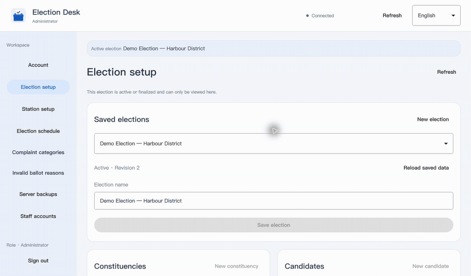
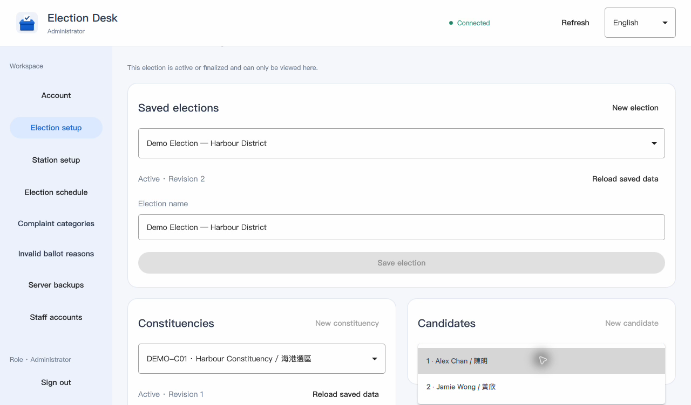
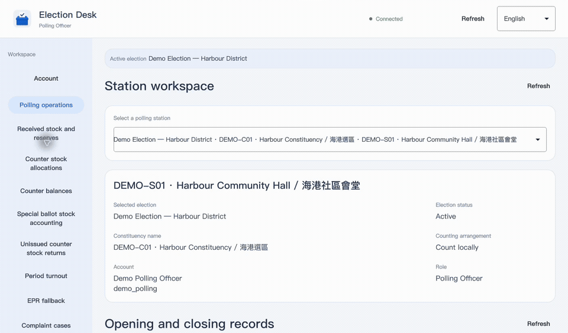
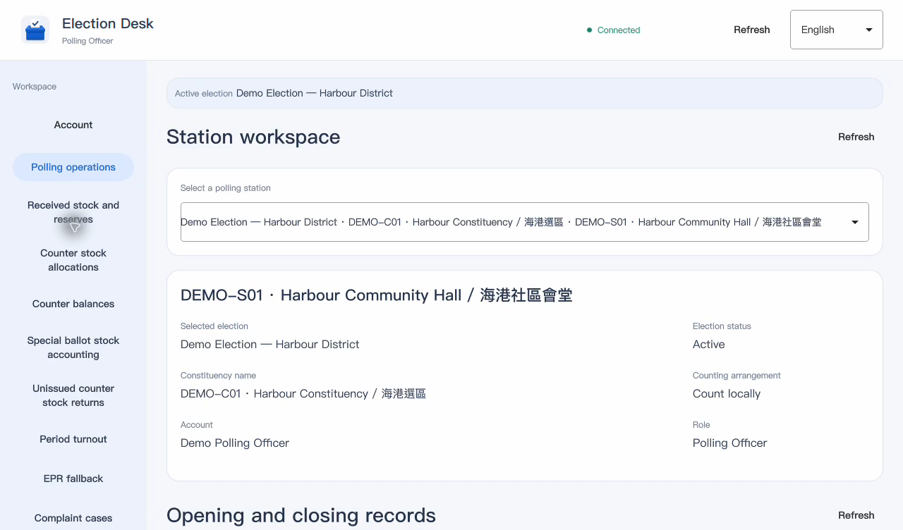
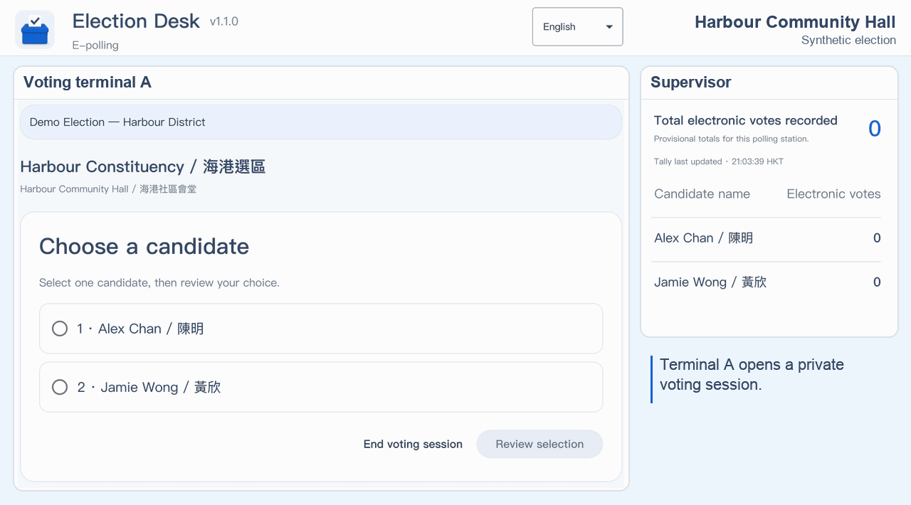
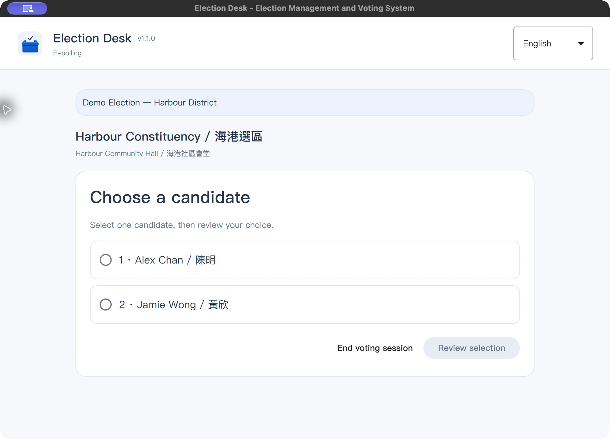
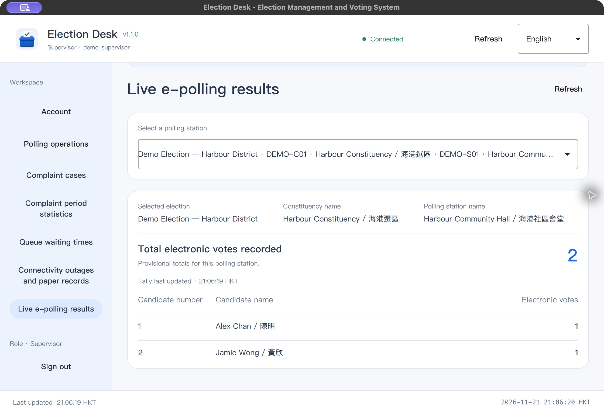

<p align="center">
  
</p>

<h1 align="center">Election Desk</h1>

<p align="center"><strong>From polling station setup to reviewed election results.</strong></p>

<p align="center">
  A Windows and macOS desktop application for election staff.
  Run in-person e-polling or administer paper-ballot polling and manual counts in one shared system.
</p>

<p align="center">
  <a href="#workflow-demos">Watch the workflows</a> ·
  <a href="#run-locally-and-load-sample-data">Try the sample election</a> ·
  <a href="demo/README.md#present-e-polling-live">Presenter walkthrough</a>
</p>

## Workflow demos

### Administrator · Review election setup

Review the active election’s constituency and candidates, then open Harbour Community Hall
to see its two issuance counters.



<details>
<summary>Election setup screenshot</summary>



</details>

### Polling Officer · Run the polling station

Open the assigned station, check the approved opening record, and save a queue observation.



<details>
<summary>Polling workspace screenshot</summary>



</details>

### Live e-polling · Voting terminal and Supervisor

The voting terminal and Supervisor client share one server. Follow the full voting screen on
the left as two terminals take turns casting demo votes and the Supervisor’s tally updates
automatically on the right.

[](readme/screenshots/e-polling-live.gif)

<details>
<summary>View both application screens</summary>

<table>
  <tr>
    <th align="left">Voting terminal</th>
    <th align="left">Supervisor live results</th>
  </tr>
  <tr>
    <td width="65%" valign="top"><a href="readme/screenshots/e-polling-voter.jpg"></a></td>
    <td width="35%" valign="top"><a href="readme/screenshots/e-polling-live-results.jpg"></a></td>
  </tr>
</table>

</details>

[Presenter walkthrough](demo/README.md#present-e-polling-live) · [Demo screenshots and reports](readme/README.md)

### English report samples

These PDFs are exports from the paper-ballot demo.

| Report | What it shows |
| --- | --- |
| [Station turnout](readme/reports/paper-turnout-en.pdf) | The approved interval with 300 voters. |
| [F4 final count](readme/reports/paper-final-count-f4-en.pdf) | The approved count and its source records, with 295 valid and 5 invalid papers. |
| [Finalized constituency results](readme/reports/paper-constituency-results-en.pdf) | The reviewed outcome, with 170 votes for Alex Chan and 125 for Jamie Wong. |

## Main features

| Workflow | What staff can do |
| --- | --- |
| Election setup | Configure constituencies, candidates, polling stations, issuance counters, schedules and staff assignments. |
| E-polling | Run successive private voting sessions and view live station totals as a Supervisor. |
| Polling operations | Record opening and closing, track ballot stock and turnout, and log queues, complaints and ballot-box handovers. |
| Counting and review | Reconcile ballot stock, record manual counts and recounts, approve specific record revisions, and preserve finalized results. |
| Reporting | Export PDF and CSV reports in English, Traditional Chinese and Simplified Chinese. |

Desktop clients connect over HTTPS to a central FastAPI service backed by MySQL 8.4. The
desktop interface uses Python 3.14 and PySide6/Qt Quick. E-polling builds on the same election
setup, station assignments, and opening approvals as paper-ballot polling, adding single-use
voting sessions and a live station tally.

## Run locally and load sample data

Install [uv](https://docs.astral.sh/uv/getting-started/installation/) and
[Docker Desktop](https://docs.docker.com/get-started/get-docker/), then start Docker Desktop
with Linux containers enabled.
Open PowerShell or a terminal in the project folder. Run the first command, wait for
`Demo ready: polling`, then run the second.

```sh
uv run --locked python scripts/prepare_demo.py start
uv run --locked --directory src python -m election.desktop --server https://localhost:8445 --ca ../.runtime/demo-e-polling/ca.pem
```

The first run needs internet access and may take several minutes to download Python, dependencies,
and Docker images.

The first command builds the API image from your current checkout and starts the API and MySQL
in Docker. It creates the demo accounts, activates the e-polling election, and approves the
opening of Harbour Community Hall. The second command launches the desktop app and connects it to
the demo on port 8445.

The sample data comes from [demo/scenario.json](demo/scenario.json). The first command creates
`.runtime/demo-e-polling/` for the local database, certificate, and generated passwords. The
directory is excluded from Git.

### Sign in

Open `.runtime/demo-e-polling/ACCOUNTS.md` in the project folder for your demo passwords.

- **Start voting.** Sign in as `demo_epolling`, select **Harbour Community Hall**, and open
  **Polling operations → Start e-polling**. After a vote is recorded, choose **Done**, check
  the next elector's eligibility, then choose **Start next voter**. The terminal stays signed in.
- **Watch the live results.** Run the desktop command again in another terminal to keep the
  voting screen open. Sign in as `demo_supervisor`, open **Live e-polling results**, and select
  **Harbour Community Hall**. The station's totals refresh every five seconds.

| Username | Role |
| --- | --- |
| `demo_admin` | Election setup and staff management |
| `demo_polling` | Polling operations |
| `demo_counting` | Ballot accounting and manual count entry for paper elections |
| `demo_supervisor` | Polling approvals and live e-polling results |
| `demo_epolling` | Dedicated e-polling terminal |

The [paper-ballot walkthrough](demo/README.md#paper-ballot-demo) covers stock, counting, and
finalized results.

### Stop and resume

Close the desktop application, then stop the local server.

```sh
docker compose -f .runtime/demo-e-polling/config.yml stop
```

Repeat the two startup commands to resume the e-polling demo with the saved data and passwords.

## Build the desktop app

Run these commands from the project folder on the target operating system.

```sh
uv sync --locked
uv run --locked --no-sync python build.py
```

PyInstaller produces a standalone Windows `.exe` or a self-contained macOS `.app` and a
distribution ZIP. The native desktop build workflow also produces downloadable artifacts.
[Desktop build workflow](.github/workflows/build-desktop.yml)

Back up an existing server and apply migration `0036_electronic_voting` before connecting v1.1.0
clients. The migration preserves existing elections as paper-ballot elections.

## Project resources

- [Demo data and presentation walkthrough](demo/README.md)
- [Server configuration example](config.example.yml)
- [Domain glossary](GLOSSARY.md)

---

COMP 8500SEF — Software Engineering · Topic 2: Election Management and Voting System
