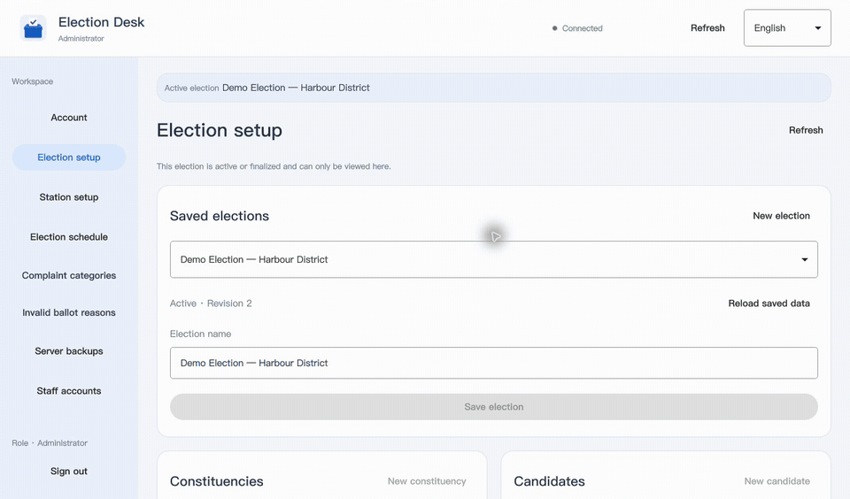
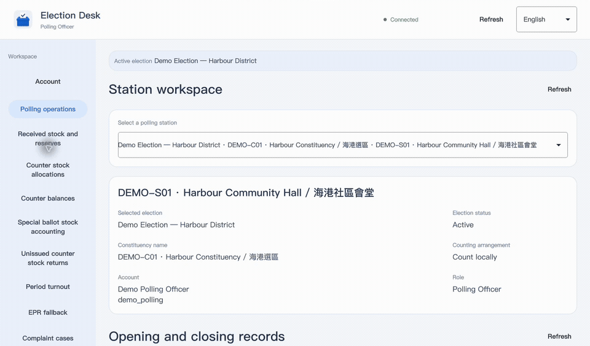

# Election Desk demo guide

Start the local demo and open the desktop from the main README. Use only the fictional election
and generated accounts for this walkthrough. [Run the demo](../README.md#run-locally-and-load-sample-data)

## Present e-polling live

1. Open a client as `demo_epolling`, select **Harbour Community Hall**, then choose
   **Polling operations → Start e-polling**. Explain that the Polling Officer opens a private
   session after checking the elector's eligibility.
2. Open a second client as `demo_supervisor`, select the same station, and keep
   **Live e-polling results** visible. The tally refreshes every five seconds.
3. At the voting terminal, choose a candidate, review the selection, and cast the demo vote.
   Pause at **Vote recorded** so the audience can see the other client update on its own.
4. Choose **Done**. After checking the next elector's eligibility, select **Start next voter**
   and show the new session with no candidate selected.

Use English from the **Language** menu if you want the screens to match the README recording.
Sign-in details are in `.runtime/demo-e-polling/ACCOUNTS.md`. For a packaged client, pass
`--server https://localhost:8445` and `--ca` with the full path to the generated public CA.

### Add a second voting terminal

Open a third client as `demo_polling` and select the same station. Open one private session on each
voting terminal, cast one vote from each, and watch the Supervisor's tally advance twice.

On the same computer, give the second terminal its own recovery directory. Set the variable in a
new terminal from the project folder, then repeat the desktop launch command.

```sh
export ELECTION_CLIENT_STATE_DIR="$PWD/.runtime/demo-e-polling/terminal-b"
```

```powershell
$env:ELECTION_CLIENT_STATE_DIR = "$PWD/.runtime/demo-e-polling/terminal-b"
```

### Rehearse and resume

Stop the local server with `docker compose -f .runtime/demo-e-polling/config.yml stop`. Rerun the
startup command to resume with the same tally and accounts. For a rehearsal starting at zero, use
a fresh directory and free port, then point all clients at that port and its generated `ca.pem`.

```sh
uv run --locked python scripts/prepare_demo.py start --directory .runtime/rehearsal --port 8446
```

Keep the generated account sheet, configuration, and local state private. The public CA is the
only generated file to distribute to other client computers.

## Paper-ballot demo

The paper demo starts on port 8444 with separate data and passwords in `.runtime/demo/`.

```sh
uv run --locked python scripts/prepare_demo.py start --voting-method paper --stage polling
uv run --locked --directory src python -m election.desktop --server https://localhost:8444 --ca ../.runtime/demo/ca.pem
```

Save open edits and repeat the start command with the stage you want. After a stage changes,
sign out and back in to reload the workspace.

| Stage | What to show |
| --- | --- |
| `polling` | Sign in as `demo_admin` to review setup or `demo_polling` to show stock, approved turnout, complaints, and queues. |
| `counting` | Sign in as `demo_counting` to show approved accounting, local box receipt, and the draft count. |
| `results` | Sign in as `demo_supervisor` to review the finalized result, or open `demo-results.pdf` or `demo-results.csv` in `.runtime/demo/`. |

The fictional count reconciles 170 votes for Alex Chan, 125 for Jamie Wong, and 5 invalid papers.
Stages only advance. Use a fresh directory and port for an earlier stage after finalization.
[English PDF samples](../readme/README.md#english-paper-ballot-reports)

<details>
<summary>Paper-ballot recordings</summary>





</details>

Stop this server with `docker compose -f .runtime/demo/config.yml stop`.

## Import into a separate demo server

Use a dedicated server with no elections, or resume a previously imported scenario using its
saved directory. Obtain the server's public CA and run the importer with the configured HTTPS
address. The Administrator password is prompted for privately.

```sh
uv run --locked python scripts/prepare_demo.py import --server https://localhost:8443 --ca ca.pem --admin admin --voting-method electronic
```

Use `--voting-method paper --stage polling` for the paper workflow. Keep the same connection
details and directory for retries or later paper stages. Open the generated account sheet in
`.runtime/demo-import-e-polling/` or `.runtime/demo-import/`, respectively, and connect the desktop
with the same server address and public CA.
