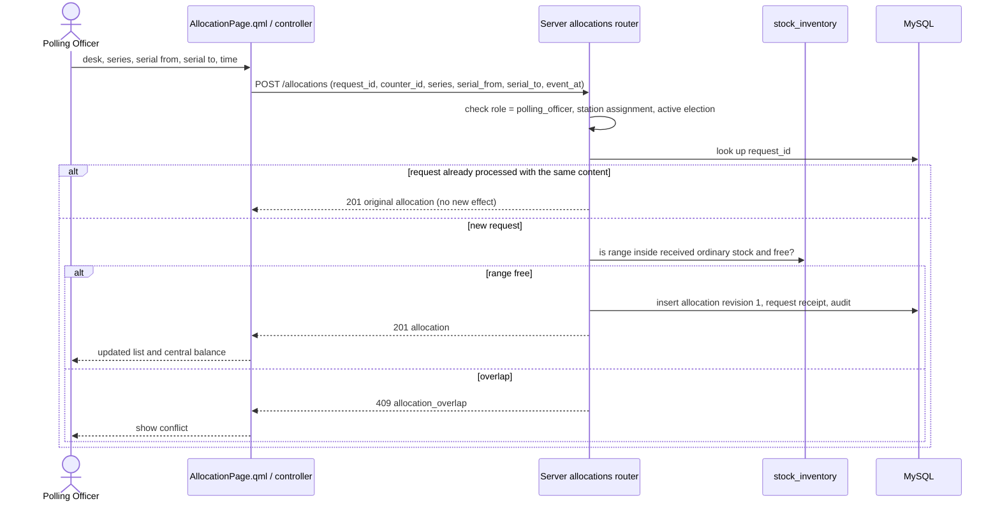

# 03. Ballot paper stock and issuing desks (P(14))

| Item | Value |
| --- | --- |
| Person in charge | Harriet |
| Reference manual | 6.2 P(14) Control sheet on the flow of ballot papers (pp. 45–53) |
| Server code | `src/election/server/stock.py`, `stock_serials.py`, `stock_inventory.py`, `allocations.py`, `stock_returns.py`, `stock_reports.py`, `allocation_reports.py` |
| Desktop code | `src/election/desktop/stock.py`, `allocations.py`, `counter_returns.py`, `qml/StockPage.qml`, `qml/AllocationPage.qml`, `qml/CounterReturnsPage.qml` |
| API | `/api/workspace/stations/{station_id}/stock`, `/allocations`, `/stock-returns` (each: `GET`, `POST`, `PUT /{id}`, `GET /{id}/history`, statement `.csv` / `.pdf`) |
| Former automated tests | `tests/test_stock_api.py`, `tests/test_allocation_api.py`, `tests/test_allocation_reports.py`, `tests/test_qml_counter_returns.py` (commit `c68fb54`) |

## 1. User requirements

- UR-03.1 The polling officer records the ballot papers received by the station, by serial
  number range, separated into ordinary papers and the two reserves.
- UR-03.2 The officer records each batch of ordinary papers handed to an issuing desk
  (P(14)): which desk, from which serial number to which, and when.
- UR-03.3 A paper can belong to only one desk at a time.
- UR-03.4 Unissued papers returned from a desk to the presiding officer can be recorded and
  given to another desk.
- UR-03.5 Every correction keeps the original entry and needs a reason.

## 2. Functional requirements

| ID | Requirement | Role | Implemented in |
| --- | --- | --- | --- |
| FR-STK-01 | The system shall record a stock receipt with ballot series, receipt time and one or more inclusive serial ranges, each belonging to one of three pools: ordinary, replacement reserve, tendered reserve. | Polling Officer | `POST /stock` (`StockInput`) |
| FR-STK-02 | The system shall reject a receipt whose declared pool quantities do not equal the quantities implied by its serial ranges. | Polling Officer | `StockInput.conserved_pools` |
| FR-STK-03 | The system shall reject a serial range that overlaps any range already received in the same series and constituency. | Polling Officer | 409 `stock_overlap` |
| FR-STK-04 | The system shall treat serial numbers as digit strings of up to 18 digits and keep leading zeros exactly as printed. | Polling Officer | `stock_serials.py` |
| FR-STK-05 | The system shall record an allocation of one ordinary serial range to one issuing desk with the hand-over time. | Polling Officer | `POST /allocations` (`AllocationInput`) |
| FR-STK-06 | The system shall reject an allocation that is outside received ordinary stock or that overlaps a range currently owned by another desk. | Polling Officer | 409 `allocation_overlap` |
| FR-STK-07 | The system shall show, for the station, the ordinary stock still held centrally and the ranges currently owned by each desk. | Polling Officer, Counting Officer, Supervisor | `GET /allocations`, `stock_inventory.py` |
| FR-STK-08 | The system shall record the return of unissued papers from a desk to the presiding officer, after which the range may be allocated again. | Polling Officer | `POST /stock-returns` (409 `return_outside_owned_stock`) |
| FR-STK-09 | The system shall allow a correction of a receipt, allocation or return only with a reason, and shall keep every earlier revision. | Polling Officer | `PUT /{id}`; `GET /{id}/history` |
| FR-STK-10 | The system shall refuse a correction that would remove papers already owned by a desk or already observed as issued. | Polling Officer | `preserve_allocations` in `stock_inventory.py` |
| FR-STK-11 | The system shall export the received-stock statement and the allocation statement as CSV and PDF. | All operational roles | `stock_reports.py`, `allocation_reports.py` |

Non-functional requirements that apply: NFR-DATA-01, NFR-REL-01, NFR-REL-02, NFR-SEC-04.

## 3. Use case UC-03: Allocate ballot papers to an issuing desk

| Field | Description |
| --- | --- |
| Actors | Polling Officer |
| Description | The officer hands a block of ordinary ballot papers to an issuing desk and records it on the P(14) page. |
| Data | Issuing desk, series, serial from, serial to, time |
| Stimulus | The officer adds an allocation on "Counter stock allocations" |
| Response | The allocation appears in the list; central ordinary stock decreases by the quantity |
| Pre-condition | The range has been received as ordinary stock and is not owned by another desk |
| Post-condition | Revision 1 of the allocation exists with actor and time; an audit event is stored |
| Comments | Quantity is derived as `serial_to − serial_from + 1` |

Main flow:

1. The officer opens "Counter stock allocations".
2. The officer selects the desk and enters series, first and last serial number, and time.
3. The system checks the range and saves the allocation.
4. The system refreshes the availability shown to all desks.

Alternative flows:

- 3a. The range overlaps another desk's range: the system rejects it and names the conflict.
- 3b. The reply is lost on the network: the client repeats the same request identifier and the
  server returns the original result without a second allocation.
- 4a. The officer entered the wrong range: the officer corrects it with a reason; the old
  range is released only if none of it has been observed as issued.

## 4. Sequence diagram

## 5. Design notes

- Receipt, allocation and return each have a head row and immutable revision rows
  (`stock_models.py`, `allocation_models.py`, `stock_return_models.py`).
- Stock is stored as intervals, not as one row per paper, so a station with a very large
  stock does not create a very large table.
- Demo data: 520 papers received in series `DEMO` (000001–000500 ordinary, 000501–000510
  replacement reserve, 000511–000520 tendered reserve); 200 papers allocated to each of two
  desks; 100 ordinary papers held centrally.

## 6. Test cases

System tests (manual, on a rehearsal copy of the paper-ballot demo server, stage `polling`):

| ID | Requirement | Pre-condition | Steps | Expected result | Result |
| --- | --- | --- | --- | --- | --- |
| TC-STK-01 | FR-STK-01, FR-STK-07 | Signed in as `demo_polling` | Open "Received stock and reserves" and "Counter stock allocations". | 500 ordinary, 10 replacement, 10 tendered; two allocations of 200; 100 held centrally | `TODO(Harriet)` + screenshot |
| TC-STK-02 | FR-STK-05 | Same | Allocate `DEMO` 000401–000450 to Counter 1. | Saved; central ordinary stock becomes 50 | `TODO(Harriet)` |
| TC-STK-03 | FR-STK-06 | TC-STK-02 done | Allocate `DEMO` 000440–000460 to Counter 2. | Rejected as overlapping; nothing saved | `TODO(Harriet)` |
| TC-STK-04 | FR-STK-06 | Same | Allocate `DEMO` 000505–000506 (replacement reserve) to Counter 1. | Rejected: not ordinary stock | `TODO(Harriet)` |
| TC-STK-05 | FR-STK-09 | TC-STK-02 done | Correct the TC-STK-02 allocation to 000401–000440 without a reason, then with a reason. | Without reason: rejected. With reason: revision 2 saved; revision 1 visible in history | `TODO(Harriet)` |
| TC-STK-06 | FR-STK-03 | Same | Record a new receipt of series `DEMO` 000500–000600 as ordinary. | Rejected as overlapping received stock | `TODO(Harriet)` |
| TC-STK-07 | FR-STK-11 | Same | Export the allocation statement as PDF in English and in Traditional Chinese. | Two files; serial numbers keep leading zeros | `TODO(Harriet)` |

Equivalence partitions for an allocation range: inside free ordinary stock (valid), partly
owned by another desk (invalid), inside a reserve pool (invalid), outside received stock
(invalid), `serial_from` greater than `serial_to` (invalid).

Automated tests (unit / API level, from the project history):

| Test | Requirement |
| --- | --- |
| `test_stock_api.py::test_assigned_officer_receives_three_pools_and_reopens_original_serials_after_restart` | FR-STK-01, NFR-REL-03 |
| `test_stock_api.py::test_ranges_cannot_overlap_between_pools_even_when_declared_totals_add_up` | FR-STK-02, FR-STK-03 |
| `test_stock_api.py::test_zero_serial_and_large_exact_serials_keep_printed_digits_and_zero_reserves` | FR-STK-04, NFR-DATA-01 |
| `test_allocation_api.py::test_two_counters_cannot_own_the_same_inclusive_serial` | FR-STK-06 |
| `test_allocation_api.py::test_exact_create_retry_has_one_effect_and_changed_payload_is_a_conflict` | NFR-REL-02 |
| `test_allocation_api.py::test_reasoned_amendment_preserves_history_and_releases_only_the_old_current_range` | FR-STK-09 |
| `test_allocation_api.py::test_receipt_correction_cannot_remove_stock_already_owned_by_a_counter` | FR-STK-10 |

## 7. Differences from the reference manual

| Manual | Election Desk | Reason |
| --- | --- | --- |
| P(14) starts at distribution to desks | A stock receipt with three pools is recorded first | Allocation can then be validated against what the station actually holds |
| P(14) records uploaded to SIC at 15 minutes past every hour | Records are on the central server as soon as they are saved | No manual upload step |
| A note in the group's draft says serial tracking is "not suitable for our case" | Serial ranges are tracked | `TODO(Harriet)`: remove the note from the draft; the implemented system tracks serial ranges and that is the requirement |
