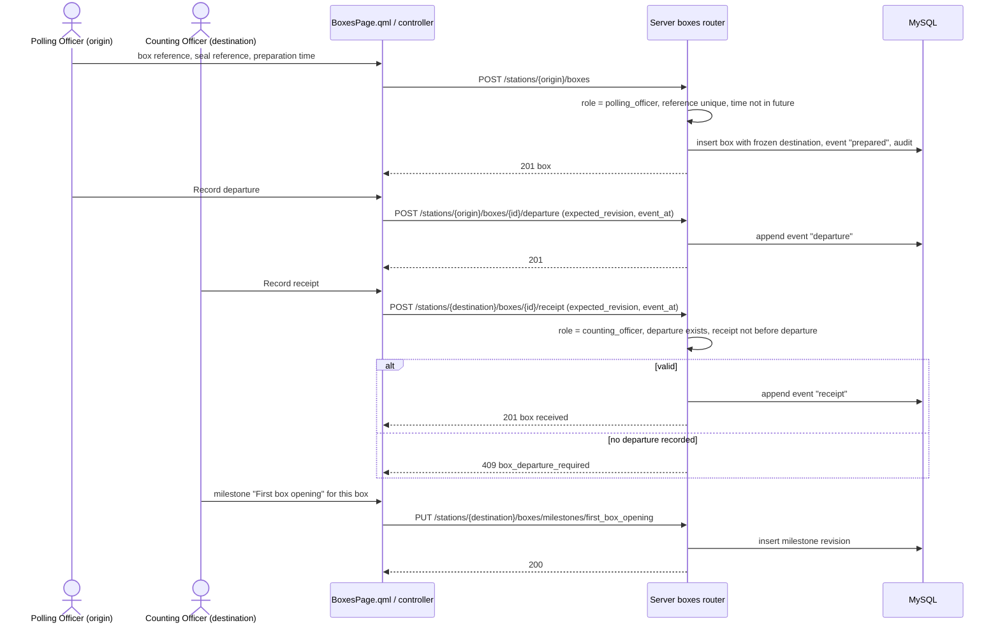

# 07. Times of actions after the poll and ballot box handover

| Item | Value |
| --- | --- |
| Person in charge | Lam |
| Reference manual | 9.1 Record the time of actions after poll (pp. 91–96) |
| Server code | `src/election/server/boxes.py`, `box_state.py`, `box_models.py`, `box_reports.py`, `counting_round_events.py` |
| Desktop code | `src/election/desktop/boxes.py`, `qml/BoxesPage.qml` |
| API | `/api/workspace/stations/{station_id}/boxes` (`GET`, `POST`, `POST /{box_id}/departure`, `POST /{box_id}/receipt`, `PUT /{box_id}/departure`, `PUT /{box_id}/receipt`, `PUT /milestones/{kind}`, `GET /{box_id}/history`, statement `.csv` / `.pdf`) |
| Former automated tests | `tests/test_box_api.py`, `tests/test_box_reports.py`, `tests/test_boxes_desktop.py` (commit `c68fb54`) |

## 1. User requirements

- UR-07.1 After the close of poll the polling officer records each sealed ballot box and, for
  a station that sends its boxes away, the time each box left.
- UR-07.2 The counting officer at the counting station records the time each box arrived.
- UR-07.3 The counting officer records the time the station finished converting into a
  counting station, the time the first box was opened, and the time the determination of
  questionable ballot papers started.
- UR-07.4 The time the count was completed is taken from the count itself and is not typed in.
- UR-07.5 A wrong time can be corrected with a reason; the first entry stays in the history.

## 2. Functional requirements

| ID | Requirement | Role | Implemented in |
| --- | --- | --- | --- |
| FR-BOX-01 | The system shall record a ballot box with box reference, seal reference and preparation time. The box reference shall be unique within its origin station and shall not be editable afterwards. | Polling Officer | `POST /boxes` (`BoxCreate`; 409 `box_reference_exists`) |
| FR-BOX-02 | The system shall set the receiving counting station of a box from the station configuration: the same station when it counts locally, otherwise its configured destination. | — | `station_models.py` (`counting_mode` = `local` / `send`) |
| FR-BOX-03 | The system shall record the departure time of a box at the origin station. | Polling Officer (origin) | `POST /boxes/{id}/departure` |
| FR-BOX-04 | The system shall record the receipt time of a box at the receiving station. A transferred box shall require a recorded departure first; a box counted locally shall not. | Counting Officer (destination) | `POST /boxes/{id}/receipt` (409 `box_departure_required`) |
| FR-BOX-05 | The system shall reject a time in the future and a receipt time earlier than the departure time. | Both | 422 `box_validation` |
| FR-BOX-06 | The system shall record three counting milestones at a counting station: conversion complete, first box opening (naming the box), start of determination of questionable ballot papers. | Counting Officer | `PUT /boxes/milestones/{kind}` (`MILESTONE_KINDS`) |
| FR-BOX-07 | The system shall keep the milestones in chronological order and shall not accept a first box opening earlier than the receipt of that box. | Counting Officer | `save_milestone` (409 `box_receipt_required`, 422 `box_validation`) |
| FR-BOX-08 | The system shall require a reason for every correction of a departure, receipt or milestone and shall keep the earlier entry. | Both | `PUT /boxes/{id}/departure`, `PUT /boxes/{id}/receipt` (422 `box_correction_reason_required`) |
| FR-BOX-09 | The system shall show the count completion time from the submitted count round and shall show "not recorded" until then. | All operational roles | `counting_round_events.py`, `box_state.py` |
| FR-BOX-10 | The system shall export the box handover and counting timeline report as CSV and PDF. | All operational roles | `box_reports.py` |

Non-functional requirements that apply: NFR-REL-01, NFR-REL-02, NFR-SEC-04, NFR-USA-02.

## 3. The nine post-poll times of the manual and where they are recorded

`TODO(Lam)`: check this mapping against the original manual page and adjust the left column.

| Time in the manual | Recorded in Election Desk as | Document |
| --- | --- | --- |
| Close of poll | "Closure to new arrivals" and "Completion of service to queued electors" | 02 |
| Departure of ballot box (small polling station) | Box departure | 07 |
| Arrival of ballot box from SPS 1 to SPS 4 | Box receipt, one record per box (no limit of four) | 07 |
| Arrival of receptacle / ballot box | Box receipt | 07 |
| Completion of conversion | Milestone "Conversion to counting station complete" | 07 |
| Opening of first ballot box | Milestone "First box opening" | 07 |
| Start of determination of questionable ballot papers | Milestone "Questionable-ballot determination started" | 07 |
| Completion of count | Derived from the count round submission | 09 |

## 4. Use case UC-07: Hand over a ballot box to the counting station

| Field | Description |
| --- | --- |
| Actors | Polling Officer at the origin station; Counting Officer at the receiving station |
| Description | After the poll a sealed box is sent from a polling station to its counting station. Each side records its own time. |
| Data | Box reference, seal reference, preparation time, departure time, receipt time |
| Stimulus | The poll has closed and the box is sealed |
| Response | The box shows "Receipt recorded" and can be included in a counting scope |
| Pre-condition | The election is active; both officers are assigned to their stations |
| Post-condition | The handover history holds preparation, departure and receipt with actor and time |
| Comments | For a station that counts its own ballot papers, step 3 is skipped |

Main flow:

1. The polling officer opens "Box handover and milestones", selects "New box", and enters box
   reference, seal reference and preparation time.
2. The system saves the box and shows its receiving counting station.
3. When the box leaves, the polling officer presses "Record departure" with the actual time.
4. When the box arrives, the counting officer at the receiving station selects it and presses
   "Record receipt" with the actual time.
5. The system marks the box as received.

Alternative flows:

- 1a. The box reference already exists at this station: the system rejects it.
- 4a. No departure has been recorded for a transferred box: the system refuses the receipt
  until the origin records the departure.
- 4b. The receipt time is earlier than the departure time: the system rejects it.
- 5a. A time was wrong: the officer of that side corrects it with a reason.

## 5. Sequence diagram

## 6. Design notes

- A box keeps its origin station and its destination station from the moment it is prepared
  (`side` = `origin` / `destination`), so each side sees the box but can write only its own
  events.
- Milestones are station-level records with revisions; only a station that counts locally can
  record them (403 `counting_station_required`).
- Manual milestones and the automatic count-round events are kept separately and shown on the
  same timeline.
- Election completion (document 10) requires every station's boxes to be received.

## 7. Test cases

System tests (manual, on a rehearsal copy of the paper-ballot demo server; see document 12 for the reason).
At stage `counting` the importer has already prepared and received box `DEMO-BOX-01` and saved
the milestones "Conversion complete" and "First box opening":

| ID | Requirement | Pre-condition | Steps | Expected result | Result |
| --- | --- | --- | --- | --- | --- |
| TC-BOX-01 | FR-BOX-01 | Stage `polling`; signed in as `demo_polling` | Open "Box handover and milestones"; "New box" with a reference, a seal reference and a past time; "Save box preparation". | Box listed with status "Preparation recorded" and receiving station Harbour Community Hall | `TODO(Lam)` + screenshot |
| TC-BOX-02 | FR-BOX-01 | TC-BOX-01 done | Create a second box with the same reference. | Rejected: reference already exists | `TODO(Lam)` |
| TC-BOX-03 | FR-BOX-05 | Same | Create a box with a preparation time in the future. | Rejected | `TODO(Lam)` |
| TC-BOX-04 | FR-BOX-04 | TC-BOX-01 done; signed in as `demo_counting` | Select the box; "Record receipt" with a time after preparation. | Status "Receipt recorded" (local counting, no departure needed) | `TODO(Lam)` |
| TC-BOX-05 | FR-BOX-04, NFR-SEC-04 | Signed in as `demo_polling` | Try to record the receipt of a box. | Not possible for a Polling Officer | `TODO(Lam)` |
| TC-BOX-06 | FR-BOX-06, FR-BOX-07 | Stage `counting`; signed in as `demo_counting` | View "Counting milestones"; try to save "First box opening" with a time earlier than the box receipt. | Seeded milestones are listed; the earlier time is rejected | `TODO(Lam)` |
| TC-BOX-07 | FR-BOX-08 | Same | Correct a saved milestone without a reason, then with a reason. | Without reason: rejected. With reason: new revision; old one in history | `TODO(Lam)` |
| TC-BOX-08 | FR-BOX-10 | Same | Export the box handover report as PDF. | File lists box, handover events and milestones in Hong Kong time | `TODO(Lam)` |

Automated tests (unit / API level, from the project history):

| Test | Requirement |
| --- | --- |
| `test_box_api.py::test_assigned_officer_prepares_a_frozen_destination_box_without_inventing_count_data` | FR-BOX-01, FR-BOX-02 |
| `test_box_api.py::test_two_station_handover_keeps_origin_and_receiver_provenance_with_one_receipt` | FR-BOX-03, FR-BOX-04 |
| `test_box_api.py::test_local_box_receipt_needs_no_departure_and_reasoned_correction_preserves_history` | FR-BOX-04, FR-BOX-08 |
| `test_box_api.py::test_missing_departure_wrong_destination_and_unreceived_box_cannot_be_acknowledged` | FR-BOX-04 |
| `test_box_api.py::test_counting_milestones_preserve_revisions_and_never_fabricate_count_completion` | FR-BOX-06, FR-BOX-09 |
| `test_box_api.py::test_box_references_are_origin_scoped_case_sensitive_and_identity_is_not_editable` | FR-BOX-01 |

## 8. Differences from the reference manual

| Manual | Election Desk | Reason |
| --- | --- | --- |
| One page with nine time fields | Boxes are records with a handover history; milestones are separate entries | A time belongs to a specific box and a specific person |
| Arrival slots "SPS 1" to "SPS 4" | Any number of boxes, each identified by reference and seal | No fixed limit; the seal reference supports chain of custody |
| One station enters both departure and arrival where relevant | Departure by the origin's Polling Officer, receipt by the destination's Counting Officer | Each side attests only what it saw |
| Completion of count recorded automatically on saving the count | Same | — |
