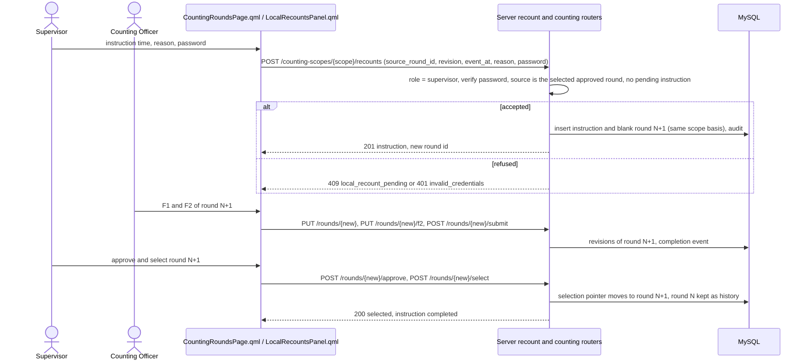
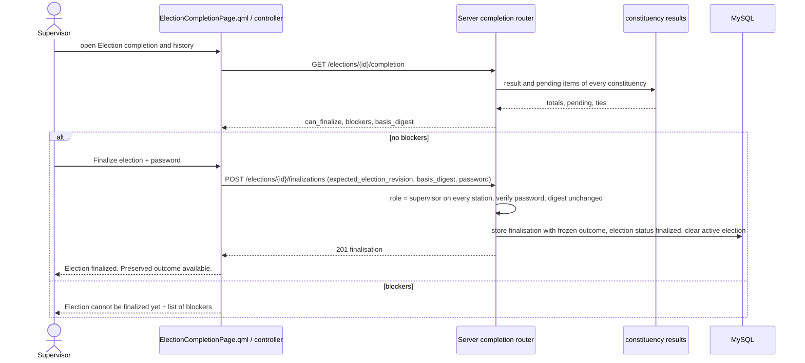

# 10. Recount, constituency result and election completion

| Item | Value |
| --- | --- |
| Person in charge | Lam |
| Reference manual | 11. Recount within a counting station; 12. Recount for the constituency; 13. Post-counting workflow (pp. 133–139) |
| Server code | `local_recounts.py`, `recount_state.py`, `recount_authority.py`, `constituency_recounts.py`, `constituency_results.py`, `constituency_ties.py`, `constituency_reports.py`, `election_completion.py`, `election_completion_reports.py` (all under `src/election/server/`) |
| Desktop code | `qml/LocalRecountsPanel.qml`, `ConstituencyRecountsPanel.qml`, `ConstituencyResultsPage.qml`, `ElectionCompletionPage.qml`; controllers `local_recounts.py`, `constituency_recounts.py`, `constituency_results.py`, `election_completion.py` |
| API | `/stations/{id}/counting-scopes/{scope_id}/recounts`; `/api/workspace/constituencies/{id}/results`, `/results/tie-resolutions`, `/recounts`; `/api/workspace/elections/{id}/completion`, `/completion/history`, `/finalizations`, `/reopenings` |
| Former automated tests | `test_local_recounts_api.py`, `test_constituency_recounts_api.py`, `test_constituency_results_api.py`, `test_constituency_tie_api.py`, `test_election_completion_api.py` and related files (commit `c68fb54`) |

## 1. User requirements

- UR-10.1 When a recount of one counting station is required, the supervisor starts it with
  a password. The account (P(18)) is kept; F1 to F4 are entered again; the earlier count is
  not lost.
- UR-10.2 When a recount of the whole constituency is instructed, every counting station of
  that constituency starts a new count.
- UR-10.3 Each count and each recount is kept as a separate round (first count, first
  recount, and so on).
- UR-10.4 The supervisor sees the result of the constituency, built only from confirmed
  counts.
- UR-10.5 When everything is confirmed, the supervisor closes the election; after that the
  records cannot be changed.

## 2. Functional requirements

Recount:

| ID | Requirement | Role | Implemented in |
| --- | --- | --- | --- |
| FR-RCT-01 | The system shall let a Supervisor instruct a recount of one counting scope, giving instruction time, reason and the Supervisor's own password. | Supervisor | `POST /counting-scopes/{scope_id}/recounts` (`local_recounts.py`) |
| FR-RCT-02 | The system shall allow a recount instruction only for a scope whose current approved round is selected, and shall refuse a second instruction while one is unfinished. | Supervisor | 409 `count_scope_not_ready`, `local_recount_pending` |
| FR-RCT-03 | On a recount instruction the system shall create a new round with all quantities blank on the same scope and account, and shall keep the earlier round and its approval unchanged. | — | `local_recounts.py` (`instruction_only` blank round) |
| FR-RCT-04 | The system shall keep the earlier selected round as the result of the scope until the new round has been submitted, approved and selected. | Supervisor | `recount_state.py`; "Previous approved selection retained; recount pending" |
| FR-RCT-05 | After a recount instruction the system shall allow only the new round to be selected. | Supervisor | 409 `local_recount_required_round` |
| FR-RCT-06 | The system shall let a Supervisor instruct a recount of a whole constituency in one action that creates a blank round in every counting scope of the constituency, or in none. | Supervisor | `POST /constituencies/{id}/recounts` (`constituency_recounts.py`) |
| FR-RCT-07 | The system shall refuse a constituency recount when the result has changed since the Supervisor loaded it. | Supervisor | `basis_digest`; 409 `constituency_result_basis_stale`, `constituency_recount_sources_stale` |
| FR-RCT-08 | The system shall show, for each recount instruction, the progress of each new round: incomplete, submitted, approved, completed. | Supervisor | `constituency_recount_state.py` |

Constituency result:

| ID | Requirement | Role | Implemented in |
| --- | --- | --- | --- |
| FR-RES-01 | The system shall calculate the valid votes of each candidate in a constituency as the sum of the selected, approved rounds of its counting scopes, each scope counted once. | Supervisor | `GET /constituencies/{id}/results` (`constituency_results.py`) |
| FR-RES-02 | The system shall list every pending item (scope not ready, no selected count, selected count out of date, box not in a scope, station without box records, recount pending) and shall mark the result as incomplete while any exists. | Supervisor | `pending` list in `constituency_results.py` |
| FR-RES-03 | The system shall not include a count that is only submitted or only approved in the candidate totals. | — | `constituency_results.py` |
| FR-RES-04 | When the highest total is shared, the system shall show the tie and let the Supervisor record which tied candidate is returned, with reason and password. | Supervisor | `POST /results/tie-resolutions` (422 `tie_candidate_invalid`, `tie_resolution_reason_required`) |
| FR-RES-05 | The system shall show the result as provisional until the election is finalised. | Supervisor | "Provisional result" / "Finalized result" |
| FR-RES-06 | The system shall export the constituency result report as CSV and PDF. | Supervisor | `constituency_reports.py` |

Election completion:

| ID | Requirement | Role | Implemented in |
| --- | --- | --- | --- |
| FR-FIN-01 | The system shall show whether the election can be finalised and list every blocker: service completion of a station missing or not approved, a pending item of a constituency result, an unresolved tie. | Supervisor | `GET /elections/{id}/completion` (`_assess_completion`) |
| FR-FIN-02 | The system shall let only a Supervisor assigned to every station of the election finalise it, with the Supervisor's own password. | Supervisor | `POST /finalizations` (403 `full_election_access_required`, 409 `election_not_ready`) |
| FR-FIN-03 | The system shall refuse finalisation when the facts have changed since the Supervisor reviewed them. | Supervisor | `basis_digest`; 409 `election_completion_basis_conflict` |
| FR-FIN-04 | On finalisation the system shall store the outcome and make all operational records of the election read-only. | — | `lifecycle.py`; FR-SYS-03 |
| FR-FIN-05 | The system shall let a Supervisor reopen a finalised election with a reason and password; the earlier finalisation stays in the history. | Supervisor | `POST /reopenings` (409 `finalized_election_required`) |
| FR-FIN-06 | The system shall keep a history of finalisations and reopenings and export the statement of each as CSV and PDF. | Supervisor | `GET /completion/history`, `election_completion_reports.py` |

System-wide and non-functional requirements that apply: FR-SYS-03, FR-SYS-04, FR-SYS-05,
NFR-REL-01, NFR-REL-02, NFR-SEC-04.

## 3. Use case UC-10: Recount a counting scope and finalise the election

| Field | Description |
| --- | --- |
| Actors | Supervisor; Counting Officer |
| Description | After the first count is announced a recount is requested. The supervisor instructs it, the counting officer counts again, the supervisor confirms the new round and finally closes the election. |
| Data | Selected round of the scope; instruction time; reason; password; new F1 and F2 |
| Stimulus | A candidate or agent requests a recount, or the returning officer instructs one |
| Response | A new selected round; updated constituency result; finalised election |
| Pre-condition | The scope has an approved and selected round (UC-09) |
| Post-condition | Both rounds are in the history; the election is Finalized and read-only |
| Comments | If no recount is needed, the flow starts at step 6 |

Main flow:

1. The supervisor opens "F1 initial tally", chooses the scope, and in the "Local scope
   recount" panel enters the instruction time and the reason, then presses "Instruct recount".
2. The system asks for the supervisor's own password and creates a blank new round. The
   earlier selection remains the result.
3. The counting officer selects the new round and enters F1 and F2 again, then submits.
4. The supervisor approves the new round with the password.
5. The supervisor selects the new round with the password. The earlier round is superseded.
6. The supervisor opens "Constituency election results" and checks the totals and that no
   pending item remains.
7. The supervisor opens "Election completion and history". The system shows "Election is
   ready for finalization".
8. The supervisor presses "Finalize election" and enters the password.
9. The system stores the outcome; the election becomes read-only.

Alternative flows:

- 1a. A recount instruction is still unfinished: the system refuses a second one.
- 2a. The password is wrong: nothing is created.
- 5a. The supervisor tries to select the earlier round again: refused; only the new round
  can be selected.
- 6a. Two candidates share the highest total: the supervisor records a tie resolution with a
  reason and password before step 7.
- 6b. The whole constituency must be recounted: the supervisor uses "Instruct
  constituency-wide recount"; steps 3 to 5 are repeated at every counting station.
- 7a. A blocker is listed: the supervisor has it resolved in its own module and refreshes.
- 9a. An error is found after finalisation: the supervisor reopens the election with a
  reason; the correction follows the normal workflow and the election is finalised again.

## 4. Sequence diagrams

Local recount:

Finalisation:

## 5. Design notes

- A recount never overwrites a count. Rounds are numbered within a scope; the "selection
  pointer" of the scope says which approved round is the result. This is the state model of
  the count round in document 00.
- `basis_digest` is a hash of the facts the supervisor saw. The server recomputes it inside
  the transaction; if another user changed something in the meantime the command is refused
  (optimistic concurrency, NFR-REL-01).
- A constituency recount is one database transaction for all scopes.
- Administrators cannot see results; they manage set-up only (separation of duties).
- Demo data, stage `results`: Alex Chan 170, Jamie Wong 125; election finalised; files
  `demo-results.csv` and `demo-results.pdf` under `.runtime/demo/`.

## 6. Test cases

System tests (manual, on a rehearsal copy of the paper-ballot demo server). TC-RCT-01 to TC-RES-02 need
an approved and selected count on an election that is still active: on the rehearsal copy at
stage `counting`, first perform TC-CNT-08, TC-CNT-09 and TC-CNT-11 of document 09 by hand.
TC-FIN-04 onwards can also be shown on stage `results`.

| ID | Requirement | Pre-condition | Steps | Expected result | Result |
| --- | --- | --- | --- | --- | --- |
| TC-RES-01 | FR-RES-01, FR-RES-05 | Count selected; signed in as `demo_supervisor` | Open "Constituency election results". | Candidate totals equal the selected round; "Required counts are complete"; "Provisional result" | `TODO(Lam)` + screenshot |
| TC-RES-02 | NFR-SEC-04 | Signed in as `demo_counting`, then `demo_admin` | Look for "Constituency election results" and "Election completion and history". | Not in the navigation for either account | `TODO(Lam)` |
| TC-RCT-01 | FR-RCT-01 | Count selected; signed in as `demo_supervisor` | Under "Local scope recount" enter time and reason; "Instruct recount"; enter a wrong password. | Refused; no new round | `TODO(Lam)` |
| TC-RCT-02 | FR-RCT-01, FR-RCT-03, FR-RCT-04 | Same | Repeat with the correct password. | New blank round listed; "Previous approved selection retained; recount pending"; constituency result shows a pending recount | `TODO(Lam)` + screenshot |
| TC-RCT-03 | FR-RCT-02 | TC-RCT-02 done | Instruct a second recount. | Refused: current instruction unfinished | `TODO(Lam)` |
| TC-RCT-04 | FR-RCT-03, FR-RCT-05 | TC-RCT-02 done | As `demo_counting` enter F1 and F2 of the new round with changed figures (for example 171, 124, 5, 0, 300 and zero outcomes); submit. As `demo_supervisor` approve and select. | New round selected; earlier round still readable in "Preserved count revisions"; instruction shows completed | `TODO(Lam)` |
| TC-RES-03 | FR-RES-01 | TC-RCT-04 done | Open "Constituency election results". | Totals now equal the new round | `TODO(Lam)` |
| TC-FIN-01 | FR-FIN-01 | Rehearsal copy at stage `polling`; signed in as `demo_supervisor` | Open "Election completion and history". | "Election cannot be finalized yet"; blockers listed (service completion missing, and others) | `TODO(Lam)` + screenshot |
| TC-FIN-02 | FR-FIN-02 | TC-RES-03 done | "Finalize election" with a wrong password, then the correct one. | Wrong: refused. Correct: "Election finalized. Preserved outcome available." | `TODO(Lam)` |
| TC-FIN-03 | FR-FIN-04, FR-SYS-03 | TC-FIN-02 done; signed in as `demo_polling` | Try to add a queue observation. | Refused: the election is read-only | `TODO(Lam)` |
| TC-FIN-04 | FR-FIN-06 | Election finalised | Select the finalisation in "Preserved completion history"; preview; export PDF. | Statement shows the preserved outcome | `TODO(Lam)` + file |
| TC-FIN-05 | FR-FIN-05 | Election finalised | "Reopen election" without a reason, then with a reason and password. | Without reason: refused. With reason: election active again; the finalisation stays in the history | `TODO(Lam)` |

Optional test for a tie (FR-RES-04), on a fresh rehearsal copy: perform the recount of
TC-RCT-04 with Alex Chan 148, Jamie Wong 148, "Unmarked" 4, questionable 0, actual 300 and
select it. Expected as TC-RES-04: "Tie is unresolved"; the completion page lists the tie as a
blocker; after "Record tie resolution" with a candidate, a reason and the password, the
blocker disappears. `TODO(Lam)`: run it, or state in the report that FR-RES-04 is covered by
the automated tests only.

Automated tests (unit / API level, from the project history):

| Test | Requirement |
| --- | --- |
| `test_local_recounts_api.py::test_supervisor_starts_a_blank_local_recount_and_preserves_the_selected_round` | FR-RCT-01, FR-RCT-03, FR-RCT-04 |
| `test_constituency_recounts_api.py::test_one_constituency_instruction_creates_two_blank_rounds_and_retains_reviewed_sources` | FR-RCT-06 |
| `test_constituency_results_api.py::test_selected_approved_mixed_scope_contributes_once_to_constituency_result` | FR-RES-01 |
| `test_constituency_results_api.py::test_submitted_count_without_selection_is_pending_and_not_a_candidate_total` | FR-RES-02, FR-RES-03 |
| `test_constituency_tie_api.py::test_supervisor_resolves_equal_zero_totals_against_exact_result_basis` | FR-RES-04 |
| `test_constituency_tie_api.py::test_tie_resolution_rejects_nonleader_blank_reason_wrong_password_and_unauthorized_roles` | FR-RES-04 |
| `test_election_completion_api.py::test_supervisor_sees_actual_polling_completion_missing_for_each_required_station` | FR-FIN-01 |
| `test_election_completion_api.py::test_result_affecting_tie_requires_current_supervisor_resolution` | FR-FIN-01, FR-RES-04 |
| `test_election_completion_api.py::test_latest_instructed_constituency_recount_blocks_election_readiness` | FR-FIN-01, FR-RCT-06 |
| `test_election_completion_api.py::test_fully_reviewed_active_election_is_ready_despite_provisional_display` | FR-FIN-02 |

## 7. Differences from the reference manual

| Manual | Election Desk | Reason |
| --- | --- | --- |
| "Recount" button on F4; data in F1 to F4 "will be cleared" | A new blank round is created; the earlier round is kept and stays the result until the new one is selected | No count is ever deleted; there is always one confirmed result |
| "First DCGC Recount", "Second DCGC Recount" menu options chosen at each station | One Supervisor instruction creates the new round in every counting scope of the constituency | The stations cannot get out of step |
| Result is uploaded to SIC and verified there by phone and fax | The Supervisor reviews the constituency result in the system | Stand-alone system |
| No step to close the election | "Finalize election" with history and reopening | Needed to make the records read-only and to support retirement of the data (document 13) |
| Section 13: downloading files and reading announcements through the tablet management app | Not implemented | Device management is outside the system boundary |
